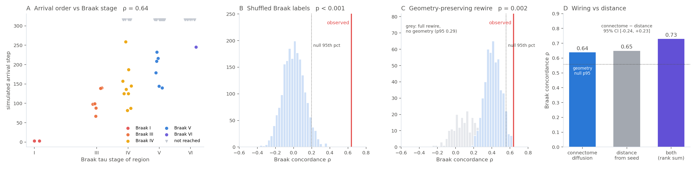
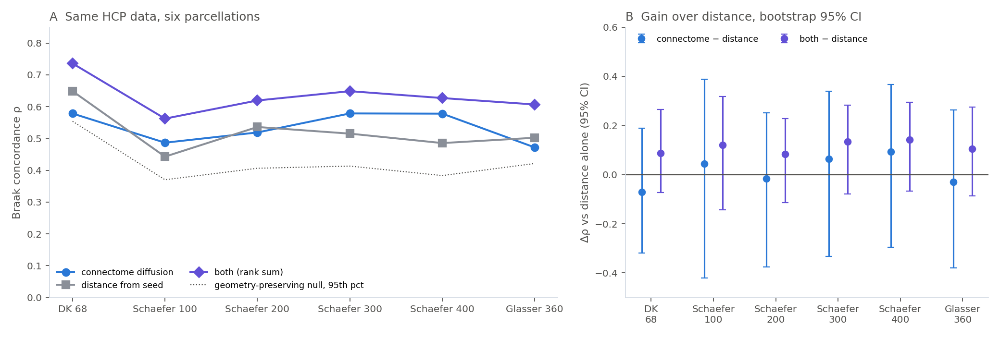
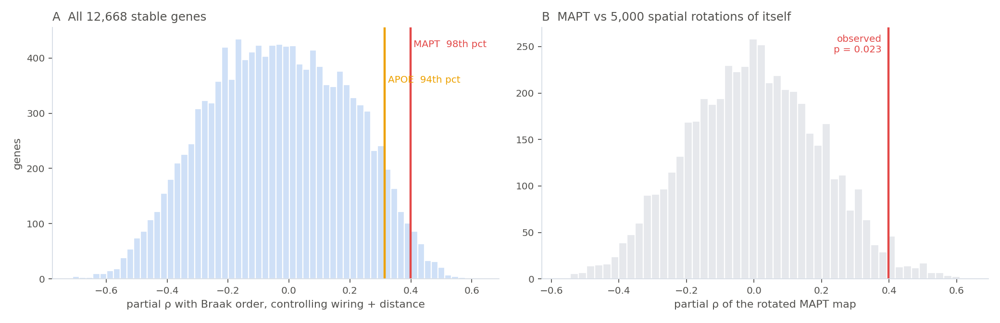

# Connectome Spread

Interactive simulation of Alzheimer's tau pathology spreading along the brain's
structural wiring, tested against Braak staging, with APOE genotype as a tunable
what-if parameter.

**Site:** https://oluwatobaoyagbemi.github.io/Connectome-Spread  
**Simulator:** https://connectome-spread.streamlit.app  
**Reproduce every number below:** `python reproduce.py` · **Tests:** `pytest -q`




## Result

Give a linear network-diffusion model nothing but a real human connectome and a
seed in the entorhinal cortex, and the order in which cortical regions are reached
correlates with Braak tau staging at **Spearman ρ = 0.64**. Parahippocampal and
fusiform cortex arrive first (Braak III), then temporal pole, cingulate and insula
(IV), then association cortex (V), with primary sensorimotor and visual cortex
(VI) mostly last or not at all.

**But straight-line distance from the entorhinal cortex does just as well
(ρ = 0.65), with no model at all.** Braak stages are laid out in space, spreading
outward from the medial temporal lobe, so anything that spreads smoothly away from
the seed will correlate with them. This is the baseline connectome-spread claims
most need to beat, and at this resolution the group connectome does not beat it.

What the connectome does do is carry information that distance lacks:

- The two orders agree only weakly with each other (ρ = 0.44; 0.33 when every region arrives).
- Controlling for distance, connectome arrival still predicts Braak stage
  (partial ρ = **0.52**; 0.56 when every region arrives).
- Adding the two rank orders, equally weighted and with nothing fitted, gives
  **ρ = 0.73** (0.76 when every region arrives). The gain over distance alone is
  suggestive, not conclusive: bootstrap 95% CI **[−0.04, +0.23]**.
- The connectome gets lingual, isthmus cingulate and lateral orbitofrontal cortex
  right where distance gets them wrong. It gets primary visual cortex
  (pericalcarine, cuneus; Braak VI) wrong, pulling it in early through strong
  occipital connections.

So the claim this repository supports: **the wiring is not a better ruler than
distance, but it is a different one, and Braak staging looks like a mix of both.**

| control | what it tests | result |
|---|---|---|
| Shuffle Braak labels (2,000 permutations) | could any labelling of this arrival sequence score this high? | null mean 0.00, 95th pct **0.20**, p < 0.001 |
| Rewire connectome (200 graphs, same density and weights) | does any graph of this density do as well? | null mean 0.10, 95th pct **0.29**, p = 0.005 |
| Rewire only among pairs at similar distance (500 graphs) | does the specific wiring matter beyond geometry? | null mean 0.41, 95th pct **0.56**, p = 0.002 |
| Distance from the seed, no model | does the connectome beat a ruler? | ρ = **0.65**; connectome − distance 95% CI [−0.24, +0.23] |
| Move the seed (bilateral) | is the entorhinal start special? | fusiform +0.44 · superior parietal −0.23 · pericalcarine +0.12 · precentral **−0.39** |
| Lower the arrival threshold to 0.02 | does the ordering survive when every region arrives and nothing ties for last? | all 68 reached, ρ = **0.62** |

The full rewire is the weak null: it scrambles space along with wiring, so a
distance-like pattern beats it easily. The geometry-preserving rewire keeps the
near-strong, far-weak structure and shuffles only which specific regions connect
(after Betzel & Bassett, *PNAS* 2018). Geometry alone gets to 0.41, and the real
wiring still beats it. Bootstrap CIs resample the 34 bilateral region pairs,
since left and right copies of a region are not independent.

Seeding a late-stage region runs the cascade backwards and the correlation flips
sign. Distance from that seed does the same, so the seed control shows where Braak
staging starts more than it shows anything about the wiring.

## Does a finer parcellation help the connectome?

An obvious objection to the result above is that 68 regions is coarse, and the
wiring might only beat distance at higher resolution. `resolution.py` reruns the
comparison on five finer parcellations of the same HCP data: Schaefer
100/200/300/400 and Glasser 360, all from the ENIGMA Toolbox.



| atlas | parcels | connectome | distance | both | partial ρ, connectome \| distance | connectome − distance, 95% CI | geometry null p |
|---|---|---|---|---|---|---|---|
| Desikan-Killiany | 68 | 0.58 | 0.65 | 0.74 | 0.54 | [−0.32, +0.19] | 0.025 |
| Schaefer | 100 | 0.49 | 0.44 | 0.56 | 0.42 | [−0.42, +0.39] | 0.005 |
| Schaefer | 200 | 0.52 | 0.54 | 0.62 | 0.42 | [−0.38, +0.25] | 0.005 |
| Schaefer | 300 | 0.58 | 0.52 | 0.65 | 0.50 | [−0.33, +0.34] | 0.005 |
| Schaefer | 400 | 0.58 | 0.49 | 0.63 | 0.50 | [−0.30, +0.37] | 0.005 |
| Glasser | 360 | 0.47 | 0.50 | 0.61 | 0.42 | [−0.38, +0.26] | 0.005 |

**Finer resolution does not let the connectome beat distance.** The point
estimates go both ways (connectome ahead by up to 0.09 at Schaefer 300/400,
behind at DK-68, Schaefer 200 and Glasser), and every CI on the difference spans
zero by a wide margin. **The rest of the DK-68 result replicates at every
resolution:**

- The connectome carries Braak information that distance lacks (partial ρ 0.42–0.54).
- It beats the geometry-preserving null (p ≤ 0.025).
- Adding the two orders beats either one alone (gain over distance +0.08 to
  +0.14). No single CI excludes zero, and the six atlases are not independent
  tests, so this stays suggestive.

Method notes, because each of these choices could change the answer:

- **Ordering by final load, not arrival.** This table ranks regions by pathology
  load at the last step, which is why the DK-68 connectome scores 0.58 here and
  0.64 in the Result section. A fixed arrival threshold cannot be compared across
  atlases: the model reaches a steady state in which finer parcels plateau lower,
  and at the DK-tuned threshold only 5–15 of 200–400 parcels ever "arrive".
  Running longer does not help, and neither does scaling the threshold by parcel
  count (only 24–34% of parcels arrive at 200–400 parcels).
- **Braak labels** come from the Desikan-Killiany region each parcel mostly
  overlaps on the fsaverage5 surface; parcels mostly on the medial wall (≤ 9 per
  atlas) are left out of the score but stay in the network.
- **Seed:** the parcels in each hemisphere that are mostly entorhinal, otherwise
  the most entorhinal one. Schaefer atlases cover entorhinal cortex poorly: at
  Schaefer 100 the seed is a temporal-pole parcel only 12–16% entorhinal. Three
  alternative seed definitions (`seed_sensitivity`) move ρ by ≤ 0.11 and leave
  the conclusions unchanged.
- **CIs** resample the 34 parent Desikan-Killiany regions, so atlases with more
  parcels do not get narrower intervals from parcels that are not independent.
- **The connectome gets its best shot:** sweeping β from 0.01 to 0.20 raises its
  ρ by at most 0.05 at any atlas (distance has no parameters to tune).

The ordering is β-sensitive, and the app sweeps β from 0.01 to 0.20 for every
genotype. For ε3/ε3, ρ peaks at β ≈ 0.02 (0.69) and declines gradually, staying
≥ 0.5 up to β ≈ 0.19; for ε4/ε4 it falls below 0.5 by β ≈ 0.08, because faster
spread lets strongly connected distant hubs (e.g. superior parietal) jump the
queue. The result is a window, and the window narrows with risk genotype.

## Model

Network diffusion on a connectome, after Raj, Kuceyeski & Weiner (*Neuron* 2012),
with a clearance term and a constant seed added:

```
dx/dt = −β · L·x − κ · x + seed
```

| term | meaning |
|---|---|
| `x` | pathology load per region |
| `L` | normalised graph Laplacian of the connectome `W` |
| `β` | spread rate along connections |
| `κ` | clearance rate |
| `seed` | constant production in the chosen seed region(s) |

Integrated with explicit Euler at dt = 1. The normalised Laplacian has
λ_max ≈ 1.28, so the scheme is stable across the whole slider range
(β·λ_max < 0.5 even at the ε4/ε4 maximum). **Time steps are dimensionless**: only
the order and relative timing of arrivals carry meaning, not years.

**APOE.** Genotype scales β and κ (ε4/ε4: spread ×1.8, clearance ×0.5; ε2/ε2:
×0.7, ×1.4; ε3/ε3 reference). The direction follows the literature — ε4 carriers
accumulate tau faster on tau-PET (Therriault et al., *JAMA Neurol* 2020) and ApoE
isoforms differ in brain clearance, ε4 slowest (Castellano et al., *Sci Transl
Med* 2011) — but the magnitudes are illustrative, not fitted. So the genotype
curves show the model's assumptions played forward; the Braak ordering is the
finding.

| genotype | total load (300 steps) | regions reached | Braak concordance ρ |
|---|---|---|---|
| ε2/ε2 | 5.6 | 8 | 0.55 |
| ε2/ε3 | 6.4 | 17 | 0.67 |
| ε3/ε3 | 7.3 | 24 | 0.64 |
| ε3/ε4 | 9.0 | 40 | 0.57 |
| ε4/ε4 | 11.5 | 63 | 0.54 |

Defaults: bilateral entorhinal seed, β = 0.05, κ = 0.01, 300 steps, arrival
threshold 0.10.

## What the app shows

1. **Spread** — total pathology over time for all five genotypes, and a heatmap of every region over time sorted by arrival
2. **Regions** — final regional load ranked and coloured by lobe; arrival table with each region's Braak stage
3. **β sensitivity** — Braak concordance across spread rates, for every genotype, with the ≥ 0.5 window reported
4. **Controls** — the two null distributions, the seed control and the threshold control above, recomputed live for the current seed and parameters
5. **Seeds & lesions** — every region as a seed; every region removed in turn
6. **Model & data** — equation, APOE multipliers, provenance, limitations

## Data

- **Connectome.** Group-average structural connectivity from Human Connectome
  Project diffusion MRI, 68 cortical regions of the Desikan-Killiany atlas, as
  distributed with the ENIGMA Toolbox (Larivière et al., *Nature Methods* 2021;
  BSD-3). Values are log-transformed streamline counts. Bundled in
  `data/hcp_dk68_sc.csv`; provenance in `data/README.md`.
- **Braak reference.** Cortical regions grouped into tau Braak stages following
  the tau-PET ROI scheme of Schöll et al. (*Neuron* 2016). Stage II is hippocampal
  and absent from the cortical parcellation, so stages run I, III, IV, V, VI.
- **Region centroids.** Mean vertex position of each Desikan-Killiany region on
  the fsaverage5 surface, from the same ENIGMA Toolbox; used only for the distance
  controls. Bundled in `data/dk68_centroids.csv`; regenerate with
  `python data/make_centroids.py`.
- **Finer parcellations.** HCP structural connectomes for Schaefer 100–400 and
  Glasser 360 from the same ENIGMA Toolbox and pipeline, with parcel centroids
  and parent Desikan-Killiany regions computed from its fsaverage5 surface
  labels. Bundled in `data/atlases/`; regenerate with `python data/make_atlases.py`.
- **Gene expression.** Allen Human Brain Atlas microarray data mapped to the
  Desikan-Killiany atlas (ENIGMA Toolbox extras; genes with differential
  stability r > 0.2), left hemisphere. Bundled in `data/ahba_dk34_lh.csv.gz`
  with sphere centroids for spin tests; regenerate with `python data/make_expression.py`.
- **Concordance.** Spearman ρ between simulated arrival step and Braak stage.
  Regions that never arrive are ranked last (tied); the threshold control checks
  that this does not drive the result.

Also available in the app: a synthetic lobe-based toy connectome (ρ = 0.38 with
the same seed — it carries the lobe structure but not the real wiring), or upload
your own CSV with region labels in the first row and column.

## Limitations

- At group level, connectome diffusion does not outperform Euclidean distance
  from the seed at any of six parcellations (68–400 regions). Individual
  connectomes and regional tau-PET targets are where that comparison should go next.
- The reference is Braak *stage*, five ordinal levels over 68 regions, so many
  regions tie. Regional tau-PET values would be a sharper target.
- APOE multipliers are directional and illustrative, not fitted to imaging or
  biomarker data.
- Group-average connectome: no individual variation in wiring.
- Linear diffusion ignores regional vulnerability, protein-specific kinetics, and
  vascular contributions (the brain–heart axis this project grew out of).
- Braak staging is a tau/Alzheimer's reference; the model is agnostic to the
  protein, so other proteinopathies need their own staging scheme.
- Streamlit Community Cloud sleeps after inactivity; the first visit may take a
  minute to wake.

## Does gene expression explain what wiring and distance miss?

Wiring and distance together reach ρ = 0.74 and still leave much of Braak order
unexplained. One long-standing explanation is selective vulnerability: some
regions accumulate tau because of what their cells express, not only because of
where they sit in the network. `vulnerability.py` tests this with Allen Human
Brain Atlas expression (Hawrylycz et al., *Nature* 2012), as mapped to these
regions by the ENIGMA Toolbox.



| | MAPT (tau; primary) | APOE (secondary) |
|---|---|---|
| ρ with Braak order, alone | +0.27, spin p = 0.10 | +0.57, spin p = 0.016 |
| partial ρ, controlling wiring + distance | **+0.40, spin p = 0.023** | +0.31, spin p = 0.079 |
| rank among 12,668 genes (partial) | 98th percentile | 94th percentile |
| wiring + distance (0.74) plus the gene | 0.79, gain 95% CI [−0.11, +0.24] | 0.81, gain 95% CI [−0.07, +0.25] |

**MAPT barely tracks Braak order by itself, but it explains part of what wiring
and distance miss.** This fits a "spreads along the network, builds up where
regions are vulnerable" account. The partial correlation survives dropping any
single region (range 0.32–0.52), dropping the entorhinal seed (0.39), the
unfiltered gene table, and other model settings (0.40–0.42).

**What it does not show.** Adding MAPT does not measurably improve prediction:
the CI on the gain spans zero. MAPT is in the top 2% of genes, not unique:
261 genes score higher. Its standing comes from having been named in advance,
not from beating the genome. With 34 regions and
two genes tested, p = 0.023 is suggestive, not decisive.

How it was tested, because expression maps make false positives easy:

- **MAPT and APOE were chosen before looking at results**, and the sign is fixed
  in advance: a positive ρ means higher expression in regions tau reaches first.
- **Spin test.** Expression varies smoothly across the cortex, and the raw
  correlation of genes with Braak order runs from −0.62 to +0.56 (5th–95th
  percentile) on spatial gradients alone. The spin test rotates each gene's map
  on the sphere 5,000 times, which keeps its smoothness and breaks its alignment
  (Alexander-Bloch et al., *NeuroImage* 2018; unique reassignment after Váša et
  al., *Cerebral Cortex* 2018).
- **Genome rank.** Asks whether the gene is special or one of many with a
  similar gradient.
- **Left hemisphere only** (34 regions). Only two of the six atlas donors
  contributed right-hemisphere samples.

**Where this sits.** It replicates, on open data and in a few seconds, the
direction of published work. Grothe et al. found regional MAPT expression tracks
the Alzheimer's neurodegeneration pattern ([*Brain* 2018](https://doi.org/10.1093/brain/awy189)).
Anand, Raj et al. related risk-gene expression to the tau-PET that a fitted
network-diffusion model fails to explain, the same logic as the partial
correlation here ([*Brain* 2025](https://doi.org/10.1093/brain/awaf179)). One
point of tension: Xiao, Vogel et al. report that network dynamics mostly set
*where* tau goes, while MAPT expression and other regional factors shape *how
much* builds up ([preprint, 2026](https://doi.org/10.21203/rs.3.rs-8687892/v1)).
Here MAPT adds information about the *order*, though Braak stage is a much
coarser target than their regional tau-PET.

## Beyond the reproduction: two scans

Everything above reproduces a published model with controls. Two analyses in
`analysis.py` ask questions the original paper did not, on the same wiring:

**Seed scan — can the cascade start anywhere?** Seed every one of the 34
bilateral region pairs in turn. The concordance a seed produces falls with the
seed's own Braak stage (Spearman **−0.69** across 34 seeds; stage I/III seeds
average 0.52 higher ρ than stage V/VI seeds). Entorhinal is first (0.64),
followed by temporal pole (0.53), fusiform (0.44) and parahippocampal (0.40),
while every stage V/VI seed scores ≤ 0.23 and most run the cascade backwards
(postcentral −0.42, precentral −0.39). **Straight-line distance from each seed
gives nearly the same picture** (Spearman −0.62, entorhinal also first), so this
is mostly a statement about the geometry of Braak staging. It does not show that
the wiring singles out the clinical origin.

**Lesion scan — which regions carry it?** Remove one region pair at a time and
re-run from the entorhinal seed, scoring concordance over the surviving regions
only (so a removed region is not penalised for never arriving). The four removals
that hurt most are temporal pole (Braak IV) and all three Braak III regions
(fusiform, parahippocampal, lingual; Δρ −0.03 to −0.05). Removing late-stage hubs
(precuneus, pericalcarine, anterior cingulate) *raises* concordance slightly:
they are shortcuts that let pathology jump the queue. The effect does not track
how strongly connected a region is (strength vs Δρ, Spearman −0.08), so it is
about position in the network, not hubness. **Effects are modest** — no single
lesion changes ρ by more than 0.05 — and the ordering, not the magnitude, is the
result.

Both scans run live in the app's *Seeds & lesions* tab for any genotype and
parameters, and are reproduced by `reproduce.py`.

## Fitting APOE instead of asserting it

`fit.py` and `fit_apoe.py` are the path from assumed multipliers to measured
ones. Given a regional tau-PET table (one SUVR per Desikan-Killiany region, per
APOE group), `fit_apoe.py` finds the (β, κ) that best reproduce each group's
pattern and reports the implied genotype multipliers with bootstrap 95% CIs:

```
python fit_apoe.py --demo              # pipeline on synthetic data; recovers planted ×1.8 / ×0.5
python fit_apoe.py data/tau_pet.csv    # your data, in the format of data/tau_pet_template.csv
```

**What a snapshot can and cannot tell you.** Parameter-recovery tests
(`tests/test_fit.py`) show that one cross-sectional pattern pins down the ratio
β/κ but not β and κ separately — slow spread with slow clearance looks like fast
spread with fast clearance. Two time points (baseline + follow-up) recover both
to within ~15%. So the data to look for is **longitudinal** tau-PET split by
genotype; Baek et al. (*Alz Res Ther* 2020) is a 2-year ε4+/ε4− dataset with
regional SUVRs, and ADNI, A4/LEARN and BioFINDER-2 have the individual-level
versions. Connectome-based tau models with APOE parameterised regionally have
been explored on BioFINDER-2 (Xiao, Vogel et al., AAIC 2024); this project's
contribution would be a per-genotype global (β, κ) fit with stated identifiability,
on open data, reproducible from one script.

## Next steps

- Rerun the connectome-vs-distance comparison against regional tau-PET instead of
  Braak stage, where the target is continuous and has far fewer ties
- Obtain longitudinal regional tau-PET by APOE group and run `fit_apoe.py`; replace
  `APOE_PROFILES` with the fitted multipliers if they are supported
- Lesion scan on individual connectomes, to see whether the bridge regions are stable across people
- Build MAPT expression into the model as a regional vulnerability term, then test it
  against regional tau-PET, which has the resolution to show a prediction gain
- Add Braak II by extending to a parcellation that includes the hippocampus

## Repository

```
app.py            entry point: landing page, then /simulator
simulator.py      the Streamlit app
model.py          diffusion model, Braak reference, concordance
validation.py     shuffled-label, rewired and geometry-preserving nulls; distance baseline; seed and threshold controls
resolution.py     connectome vs distance on five finer parcellations, with seed sensitivity
vulnerability.py  gene expression vs Braak order beyond wiring + distance: spin tests, genome rank
analysis.py       seed scan (all 34 seeds) and lesion scan (one region removed at a time)
fit.py            fit (β, κ) to a regional tau pattern; cross-sectional and longitudinal designs
fit_apoe.py       per-APOE-group fit with bootstrap CIs and implied multipliers
connectome.py     HCP / synthetic / CSV connectome loading
reproduce.py      prints every number in this README, writes docs/figures/
mcp_server.py     the simulation as MCP tools for AI agents
build_landing.py  regenerates the numbers baked into docs/index.html
tests/            pytest regression tests for the README table and controls
data/             HCP DK-68 connectome, region centroids, finer atlases, gene expression, build scripts, provenance
docs/             landing page (GitHub Pages), figures, demo video
```

## Use it from an AI agent (MCP)

`mcp_server.py` exposes the simulation as eight tools over the Model Context
Protocol, so Claude (or any MCP client) can run it directly: `list_regions`,
`list_genotypes`, `simulate_spread`, `compare_genotypes`, `sweep_beta`,
`run_controls`, `scan_seeds`, `scan_lesions`. Every tool calls the same code
path as the app and the tests.

```
pip install "mcp[cli]"
claude mcp add connectome-spread -- python /absolute/path/to/mcp_server.py   # Claude Code
```

Claude Desktop (`claude_desktop_config.json`):

```json
{"mcpServers": {"connectome-spread": {"command": "python",
                                       "args": ["/absolute/path/to/mcp_server.py"]}}}
```

Then ask, for example: *"Seed the fusiform cortex with ε4/ε4 and list the Braak V
regions that arrive before step 150"* or *"Which single lesion hurts Braak
concordance most, and is it a hub?"* `tests/test_mcp.py` exercises the server
end to end over stdio.

## Run locally

```
pip install -r requirements.txt
streamlit run app.py
python reproduce.py       # ~1 min: tables, nulls, figure
pytest -q                 # a few seconds
python mcp_server.py      # MCP server on stdio (see above)
```

## Citation

If you use this, cite the repository (see `CITATION.cff`) and the sources it
builds on: Raj et al. 2012 for the model, Larivière et al. 2021 for the connectome,
Schöll et al. 2016 for the Braak ROI scheme.

## Author

Oluwatoba Oyagbemi — Biology / CS, CCBC Honors College. Part of a portfolio on
AI applied to cardiovascular and neurodegenerative disease. Code is MIT-licensed;
the bundled connectome keeps its BSD-3 license (`data/LICENSE-ENIGMA`).
