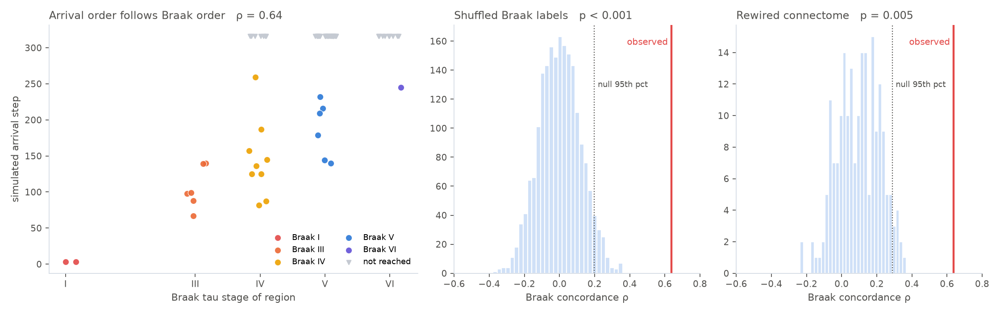

# Connectome Spread

Interactive simulation of Alzheimer's tau pathology spreading along the brain's
structural wiring, tested against Braak staging, with APOE genotype as a tunable
what-if parameter.

**Site:** https://oluwatobaoyagbemi.github.io/Connectome-Spread  
**Simulator:** https://connectome-spread.streamlit.app  
**Reproduce every number below:** `python reproduce.py` · **Tests:** `pytest -q`




## Result

Give a linear network-diffusion model nothing but a real human connectome and a
seed in the entorhinal cortex, and the order in which cortical regions are reached
correlates with Braak tau staging at **Spearman ρ = 0.64**. Temporal pole,
parahippocampal and fusiform cortex arrive first (Braak III), then cingulate and
insula (IV), then association cortex (V), with primary sensorimotor and visual
cortex (VI) last or not at all.

That number is well above what chance produces, and it depends on both the wiring
and the seed:

| control | what it tests | result |
|---|---|---|
| Shuffle Braak labels (2,000 permutations) | could any labelling of this arrival sequence score this high? | null mean 0.00, 95th pct **0.20**, p < 0.001 |
| Rewire connectome (200 graphs, same density and weights) | does the specific wiring matter? | null mean 0.10, 95th pct **0.29**, p = 0.005 |
| Move the seed (bilateral) | is the entorhinal start special? | fusiform +0.44 · superior parietal −0.23 · pericalcarine +0.12 · precentral **−0.39** |
| Lower the arrival threshold to 0.02 | does the ordering survive when every region arrives and nothing ties for last? | all 68 reached, ρ = **0.62** |

Seeding a late-stage region runs the cascade backwards and the correlation flips
sign. Only the entorhinal seed, where Braak staging begins, produces Braak order.

The ordering is β-sensitive, and the app sweeps β from 0.01 to 0.20 for every
genotype. For ε3/ε3, ρ peaks at β ≈ 0.02 (0.69) and declines gradually, staying
≥ 0.5 up to β ≈ 0.19; for ε4/ε4 it falls below 0.5 by β ≈ 0.08, because faster
spread lets strongly connected distant hubs (e.g. superior parietal) jump the
queue. The result is a window, and the window narrows with risk genotype.

## Model

Network diffusion on a connectome, after Raj, Kuceyeski & Weiner (*Neuron* 2012),
with a clearance term and a constant seed added:

```
dx/dt = −β · L·x − κ · x + seed
```

| term | meaning |
|---|---|
| `x` | pathology load per region |
| `L` | normalised graph Laplacian of the connectome `W` |
| `β` | spread rate along connections |
| `κ` | clearance rate |
| `seed` | constant production in the chosen seed region(s) |

Integrated with explicit Euler at dt = 1. The normalised Laplacian has
λ_max ≈ 1.28, so the scheme is stable across the whole slider range
(β·λ_max < 0.5 even at the ε4/ε4 maximum). **Time steps are dimensionless**: only
the order and relative timing of arrivals carry meaning, not years.

**APOE.** Genotype scales β and κ (ε4/ε4: spread ×1.8, clearance ×0.5; ε2/ε2:
×0.7, ×1.4; ε3/ε3 reference). The direction follows the literature — ε4 carriers
accumulate tau faster on tau-PET (Therriault et al., *JAMA Neurol* 2020) and ApoE
isoforms differ in brain clearance, ε4 slowest (Castellano et al., *Sci Transl
Med* 2011) — but the magnitudes are illustrative, not fitted. So the genotype
curves show the model's assumptions played forward; the Braak ordering is the
finding.

| genotype | total load (300 steps) | regions reached | Braak concordance ρ |
|---|---|---|---|
| ε2/ε2 | 5.6 | 8 | 0.55 |
| ε2/ε3 | 6.4 | 17 | 0.67 |
| ε3/ε3 | 7.3 | 24 | 0.64 |
| ε3/ε4 | 9.0 | 40 | 0.57 |
| ε4/ε4 | 11.5 | 63 | 0.54 |

Defaults: bilateral entorhinal seed, β = 0.05, κ = 0.01, 300 steps, arrival
threshold 0.10.

## What the app shows

1. **Spread** — total pathology over time for all five genotypes, and a heatmap of every region over time sorted by arrival
2. **Regions** — final regional load ranked and coloured by lobe; arrival table with each region's Braak stage
3. **β sensitivity** — Braak concordance across spread rates, for every genotype, with the ≥ 0.5 window reported
4. **Controls** — the two null distributions, the seed control and the threshold control above, recomputed live for the current seed and parameters
5. **Seeds & lesions** — every region as a seed; every region removed in turn
6. **Model & data** — equation, APOE multipliers, provenance, limitations

## Data

- **Connectome.** Group-average structural connectivity from Human Connectome
  Project diffusion MRI, 68 cortical regions of the Desikan-Killiany atlas, as
  distributed with the ENIGMA Toolbox (Larivière et al., *Nature Methods* 2021;
  BSD-3). Values are log-transformed streamline counts. Bundled in
  `data/hcp_dk68_sc.csv`; provenance in `data/README.md`.
- **Braak reference.** Cortical regions grouped into tau Braak stages following
  the tau-PET ROI scheme of Schöll et al. (*Neuron* 2016). Stage II is hippocampal
  and absent from the cortical parcellation, so stages run I, III, IV, V, VI.
- **Concordance.** Spearman ρ between simulated arrival step and Braak stage.
  Regions that never arrive are ranked last (tied); the threshold control checks
  that this does not drive the result.

Also available in the app: a synthetic lobe-based toy connectome (ρ = 0.38 with
the same seed — it carries the lobe structure but not the real wiring), or upload
your own CSV with region labels in the first row and column.

## Limitations

- APOE multipliers are directional and illustrative, not fitted to imaging or
  biomarker data.
- Group-average connectome: no individual variation in wiring.
- Linear diffusion ignores regional vulnerability, protein-specific kinetics, and
  vascular contributions (the brain–heart axis this project grew out of).
- Braak staging is a tau/Alzheimer's reference; the model is agnostic to the
  protein, so other proteinopathies need their own staging scheme.
- Streamlit Community Cloud sleeps after inactivity; the first visit may take a
  minute to wake.

## Beyond the reproduction: two scans

Everything above reproduces a published model with controls. Two analyses in
`analysis.py` ask questions the original paper did not, on the same wiring:

**Seed scan — can the cascade start anywhere?** Seed every one of the 34
bilateral region pairs in turn. The concordance a seed produces falls with the
seed's own Braak stage (Spearman **−0.69** across 34 seeds; stage I/III seeds
average 0.52 higher ρ than stage V/VI seeds). Entorhinal is first (0.64),
followed by temporal pole (0.53), fusiform (0.44) and parahippocampal (0.40) —
the Braak III territory — while every stage V/VI seed scores ≤ 0.12 and most run
the cascade backwards (postcentral −0.42, precentral −0.39). The wiring does not
merely *permit* the clinical origin; it singles it out.

**Lesion scan — which regions carry it?** Remove one region pair at a time and
re-run from the entorhinal seed, scoring concordance over the surviving regions
only (so a removed region is not penalised for never arriving). The four removals
that hurt most are temporal pole and all three Braak III regions (fusiform,
parahippocampal, lingual; Δρ −0.03 to −0.05). Removing late-stage hubs
(precuneus, pericalcarine, anterior cingulate) *raises* concordance slightly:
they are shortcuts that let pathology jump the queue. The effect does not track
how strongly connected a region is (strength vs Δρ, Spearman −0.08), so it is
about position in the network, not hubness. **Effects are modest** — no single
lesion changes ρ by more than 0.05 — and the ordering, not the magnitude, is the
result.

Both scans run live in the app's *Seeds & lesions* tab for any genotype and
parameters, and are reproduced by `reproduce.py`.

## Fitting APOE instead of asserting it

`fit.py` and `fit_apoe.py` are the path from assumed multipliers to measured
ones. Given a regional tau-PET table (one SUVR per Desikan-Killiany region, per
APOE group), `fit_apoe.py` finds the (β, κ) that best reproduce each group's
pattern and reports the implied genotype multipliers with bootstrap 95% CIs:

```
python fit_apoe.py --demo              # pipeline on synthetic data; recovers planted ×1.8 / ×0.5
python fit_apoe.py data/tau_pet.csv    # your data, in the format of data/tau_pet_template.csv
```

**What a snapshot can and cannot tell you.** Parameter-recovery tests
(`tests/test_fit.py`) show that one cross-sectional pattern pins down the ratio
β/κ but not β and κ separately — slow spread with slow clearance looks like fast
spread with fast clearance. Two time points (baseline + follow-up) recover both
to within ~15%. So the data to look for is **longitudinal** tau-PET split by
genotype; Baek et al. (*Alz Res Ther* 2020) is a 2-year ε4+/ε4− dataset with
regional SUVRs, and ADNI, A4/LEARN and BioFINDER-2 have the individual-level
versions. Connectome-based tau models with APOE parameterised regionally have
been explored on BioFINDER-2 (Xiao, Vogel et al., AAIC 2024); this project's
contribution would be a per-genotype global (β, κ) fit with stated identifiability,
on open data, reproducible from one script.

## Next steps

- Obtain longitudinal regional tau-PET by APOE group and run `fit_apoe.py`; replace
  `APOE_PROFILES` with the fitted multipliers if they are supported
- Lesion scan on individual connectomes, to see whether the bridge regions are stable across people
- Add region-level vulnerability weights from gene-expression atlases (Allen Human Brain Atlas)
- Add Braak II by extending to a parcellation that includes the hippocampus

## Repository

```
app.py            entry point: landing page, then /simulator
simulator.py      the Streamlit app
model.py          diffusion model, Braak reference, concordance
validation.py     shuffled-label null, rewired-connectome null, seed and threshold controls
analysis.py       seed scan (all 34 seeds) and lesion scan (one region removed at a time)
fit.py            fit (β, κ) to a regional tau pattern; cross-sectional and longitudinal designs
fit_apoe.py       per-APOE-group fit with bootstrap CIs and implied multipliers
connectome.py     HCP / synthetic / CSV connectome loading
reproduce.py      prints every number in this README, writes docs/figures/
mcp_server.py     the simulation as MCP tools for AI agents
build_landing.py  regenerates the numbers baked into docs/index.html
tests/            pytest regression tests for the README table and controls
data/             HCP DK-68 connectome + provenance + license; tau_pet_template.csv for fitting
docs/             landing page (GitHub Pages), figures, demo video
```

## Use it from an AI agent (MCP)

`mcp_server.py` exposes the simulation as eight tools over the Model Context
Protocol, so Claude (or any MCP client) can run it directly: `list_regions`,
`list_genotypes`, `simulate_spread`, `compare_genotypes`, `sweep_beta`,
`run_controls`, `scan_seeds`, `scan_lesions`. Every tool calls the same code
path as the app and the tests.

```
pip install "mcp[cli]"
claude mcp add connectome-spread -- python /absolute/path/to/mcp_server.py   # Claude Code
```

Claude Desktop (`claude_desktop_config.json`):

```json
{"mcpServers": {"connectome-spread": {"command": "python",
                                       "args": ["/absolute/path/to/mcp_server.py"]}}}
```

Then ask, for example: *"Seed the fusiform cortex with ε4/ε4 and list the Braak V
regions that arrive before step 150"* or *"Which single lesion hurts Braak
concordance most, and is it a hub?"* `tests/test_mcp.py` exercises the server
end to end over stdio.

## Run locally

```
pip install -r requirements.txt
streamlit run app.py
python reproduce.py       # ~1 min: tables, nulls, figure
pytest -q                 # a few seconds
python mcp_server.py      # MCP server on stdio (see above)
```

## Citation

If you use this, cite the repository (see `CITATION.cff`) and the sources it
builds on: Raj et al. 2012 for the model, Larivière et al. 2021 for the connectome,
Schöll et al. 2016 for the Braak ROI scheme.

## Author

Oluwatoba Oyagbemi — Biology / CS, CCBC Honors College. Part of a portfolio on
AI applied to cardiovascular and neurodegenerative disease. Code is MIT-licensed;
the bundled connectome keeps its BSD-3 license (`data/LICENSE-ENIGMA`).
